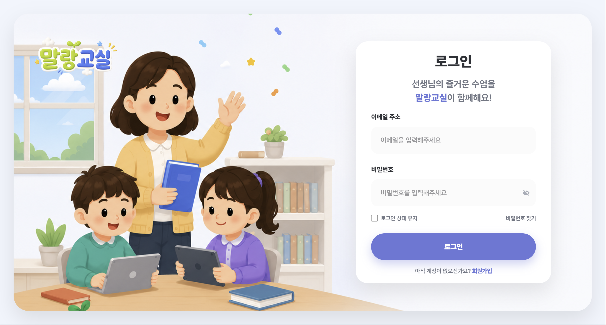
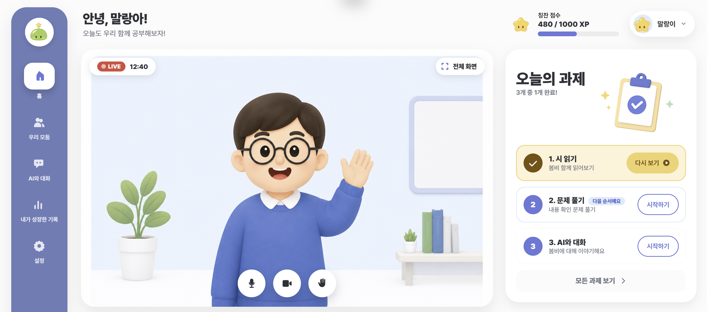
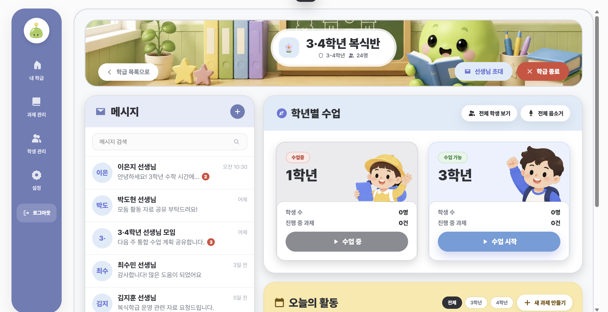

<a id="top"></a>

<div align="center">
  
  <h1>말랑교실</h1>
  <h3>여러 학년이 함께 배우는 교실, 한 명 한 명에게 맞춘 배움</h3>
  <p>한 교실에 두 학년이 앉아 있는 선생님을 위한 초등 실시간 화상 수업 서비스</p>
  <p><strong>🏆 2학기 공통프로젝트 우수상(본선진출 및 2등)</strong></p>
  <p>SSAFY 15기 · A407<br />2026.07.14 ~ 2026.08.10</p>
  
  <p>
    <a href="#overview">🏫 프로젝트 소개</a> ·
    <a href="#features">✨ 주요 기능</a> ·
    <a href="#screens">🖼️ 서비스 화면</a> ·
    <a href="#architecture">🏗️ 시스템 구성</a> ·
    <a href="#team">👥 팀 소개</a>
  </p>
</div>

---

| 🎥 학년별 실시간 수업 | 🌱 AI 맞춤 학습 | 📊 학습 기록 관리 |
| :---: | :---: | :---: |
| 화상 수업 · PDF 공유 · 실시간 판서 | 자료 기반 문제 생성 · 검수 · AI 튜터 | 출석 · 개념별 이해도 · 생활통지표 |

<br />



---

<a id="overview"></a>

## 🏫 프로젝트 소개

농어촌·도서벽지 초등학교에는 **복식학급**이 있습니다. 교실과 교사가 부족해서 **서로 다른 두 학년 이상을 한 교실에서 선생님 한 분이 동시에 가르치는 학급**입니다. 저출생으로 전국에서 계속 늘고 있습니다.

문제는 **시간**입니다. 40분 수업에서 선생님이 1학년을 지도하는 20분 동안 3학년은 비어 있고, 3학년을 지도하는 20분 동안 1학년이 비어 있습니다. 한 학년이 받는 실질 수업 시간이 절반으로 줄어듭니다.

| 복식학급의 문제 | 말랑교실의 답 |
|---|---|
| 실질 수업 시간이 절반(40분 → 20분)으로 줄어든다 | 비는 시간을 **AI 학습 보조**로 채워 학습권을 회복한다 |
| 한 학년을 가르치는 동안 다른 학년은 방치되어 결손이 쌓인다 | 학생별 약점을 짚어 **수준 맞춤 문제**를 그 자리에서 만든다 |
| 1명 학급·극소규모가 늘어 또래 상호작용이 부족하다 | **학년별 실시간 수업**으로 또래와 함께하는 경험을 만든다 |
| 학습 자료와 디지털 도구가 흩어져 있다 | 수업·자료·과제·기록을 **한 화면**에 모아 준비 부담을 줄인다 |

> 줌으로도 화상 수업은 됩니다. 하지만 줌은 "지금 3학년만 따로 수업하고 1학년에게는 과제를 내주는" 상황을 모릅니다. 말랑교실은 **거의 모든 화면이 "지금 몇 학년을 다루는지"를 알고 있습니다.**

---

## 💡 서비스의 차별점

### 🎓 학년별 수업과 과제

한 학급 안에서 **학년마다 수업을 따로 엽니다.** 3학년 수업을 진행하는 동안 1학년은 자기 과제를 풀고, 두 학년이 동시에 다른 수업을 하는 것도 됩니다. 과제도 학년 단위로 나갑니다 — 1학년 과제는 3학년 화면에 뜨지 않습니다.

### ✅ AI 생성부터 선생님 검수까지

선생님이 이미 학급에 올려 둔 수업 자료를 근거로 문제를 만듭니다. 만든 문제는 **AI가 다시 검사**하고, 마지막으로 **선생님이 검수**한 뒤에야 학생에게 공개됩니다. 선생님은 생성된 초안을 검토하고 수정해 과제를 준비합니다.

### 📈 학습 기록을 반영한 맞춤 문제

출석은 화상 서버가 실제 접속을 기록합니다(학생이 버튼을 누르는 게 아닙니다). 문항마다 개념 태그가 붙어 있어서 "이 아이는 받침 규칙이 약하다"까지 갈라집니다. 그리고 그 약점만 골라 **이 아이를 위한 문제를 지금 만듭니다.** 미리 만들어 둔 문제 은행에서 고르는 게 아닙니다.

---

<a id="screens"></a>

## 🖼️ 서비스 화면

### 🧒 학생 교실

로그인하면 **바로 교실**입니다. 방 번호를 입력하거나 링크를 받을 필요가 없습니다. 왼쪽은 선생님 방송, 오른쪽은 오늘의 과제입니다. 선생님이 수업을 시작하면 알림을 받아 자동으로 들어가고, 수업 중에 새 과제가 공개되면 새로고침 없이 목록에 올라옵니다.



화면 오른쪽 아래에는 AI 튜터 **말랑이**가 늘 떠 있습니다. 선생님이 다른 학년을 지도하는 동안 모르는 걸 물어보며 혼자 공부를 이어갈 수 있습니다.

<br>

<details>
<summary><strong>👩‍🏫 선생님 화면과 기타 화면 펼쳐보기</strong></summary>

### 🏫 선생님 · 내 학급

로그인하면 처음 보는 화면입니다. 담당 학급이 카드로 깔리고 학년·학생 수·과제 진행률이 함께 보입니다. 한 선생님이 여러 학급을 담당할 수 있고, 동료 선생님을 링크 하나로 공동 담임으로 부를 수 있습니다.


<br>

### 🎥 선생님 · 학년별 수업

복식학급이라 한 교실에 여러 학년이 섞여 있습니다. **어느 학년으로 수업을 열지 여기서 고릅니다.** 이미 진행 중인 학년은 "수업 중"으로 잠깁니다. 왼쪽에는 동료 선생님·학생과 주고받는 메시지가 있습니다.



수업을 시작하면 카메라·화면 공유·**PDF 공유와 판서**가 열립니다. 판서는 영상에 합성하지 않고 좌표만 주고받아 각자 화면에 겹쳐 그리기 때문에, 데이터가 작고 아이마다 다른 것을 보여줄 수도 있습니다. "전체 마이크 잠금" 같은 제어는 **서버가 거부하는 방식**이라 학생이 브라우저에서 버튼을 되살려도 통하지 않습니다.

<br>

### 📊 선생님 · 학생 관리

학급 학생을 한 화면에서 봅니다. 출석·학습 진도·AI 주의 학생이 위쪽에 요약되고, 학생을 고르면 오른쪽에 상세가 열립니다.


상세에서는 전체 진도, 최근 4주간 변화, 과목별 이해도와 **부족한 영역 TOP 3**를 봅니다. 여기서 바로 **맞춤 문제 만들기**로 이어지고, 학기 말에는 성적·출석·관찰 기록을 근거로 **생활통지표 초안**을 받아 고친 뒤 학부모 메일로 보낼 수 있습니다.


> 수치는 색만으로 구분하지 않고 항상 퍼센트를 함께 적습니다.

<br>

### 📝 선생님 · 과제 관리

과제를 만들고 결과를 봅니다. 제출률·평균 점수·**가장 많이 틀린 문제**·미제출 학생이 한눈에 요약되고, 아래에서 틀린 문제 TOP 3와 AI 분석 코멘트를 확인합니다.


새 과제는 단계별 마법사로 만듭니다. 과목·학년·유형·문항 수를 고르고 학습 자료를 체크하면 AI가 초안을 만듭니다. **저장과 공개는 분리되어 있습니다** — 실수로 발행되면 되돌릴 수 없기 때문입니다.

<br>

### 🗂️ 회원가입과 학급 선택

<table>
<tr>
<td width="50%">

**회원가입** — 선생님만 직접 가입합니다. 이름·재직 학교·이메일·비밀번호.


</td>
<td width="50%">

**학급 선택** — 학급을 고르지 않은 채 관리 메뉴로 들어오면 거치는 화면입니다.


</td>
</tr>
</table>

> **학생은 스스로 가입하지 않습니다.** 초등학생은 이메일이 없는 경우가 많아, 선생님이 CSV로 계정을 만들어 주거나 초대 링크로 발급합니다. 소셜 로그인을 쓰지 않는 이유도 같습니다.


</details>

---

<a id="features"></a>

## ✨ 주요 기능

| 영역 | 선생님 | 학생 |
|---|---|---|
| **계정** | 이메일 가입 · 동료 선생님 초대(링크) · 학생 계정 CSV 일괄 발급 · 비밀번호 초기화 | 선생님이 준 아이디로 로그인 |
| **학급** | 복수 학급 담당 · 학년별 구성 · 구성원 관리 · 학급 이름 수정/삭제 | 로그인 시 소속 학급으로 자동 입장 |
| **실시간 수업** | 학년별 수업 개설 · 카메라/화면 공유 · **PDF 공유 + 실시간 판서** · 전체/개별 마이크·카메라 제어 · 쉬는 시간 화면 잠금 | 선생님 방송 시청 · 마이크/카메라 · **손들기** · 전체 화면 |
| **과제** | **AI 문항 생성**(객관식·OX·받아쓰기·조사 고르기·퀴즈) · 검수·수정·삭제 · 대상 지정(학년 전체/개인) · 공개 토글 | 오늘의 과제 · 즉시 채점 · 다시 보기 · 받아쓰기 TTS 듣기 |
| **학습 기록** | 출석(화상 접속 기반) · 과목별·개념별 이해도 · 학급 이해도 히트맵 · 관찰 메모 · **맞춤 문제 생성** · **생활통지표 AI 초안 + 메일 발송** | 내 진도 · 오답 다시 보기 |
| **소통** | 학생 1:1 답장 · 선생님 단체방 · AI 튜터 **위험 신호 알림** | 선생님에게만 보내는 쪽지 · **AI 튜터 말랑이** |
| **학습 자료** | PDF 업로드 · 스캔본 OCR 전사 · 수업 중 자료 전환 | — |

---

<a id="ai"></a>

## 🤖 AI 학습 지원

학습 자료를 바탕으로 초안을 만들고, **자동 검증과 선생님 검수**를 거쳐 공개합니다.

| 단계 | 내용 |
| :--- | :--- |
| 📖 자료 기반 생성 | 선생님이 올린 자료에서 문제를 만들고 문항마다 근거 인용을 첨부합니다. |
| 🔍 자동 검증 | 학생에게 제시되는 인용문만으로 풀 수 있는지 확인합니다. |
| ✅ 선생님 검수 | 문항을 수정·삭제한 뒤 저장하고, 별도로 공개합니다. |

| 쓰는 곳 | 하는 일 |
|---|---|
| 과제 생성 | 학습 자료를 근거로 문항·정답·해설 초안 작성 |
| 문항 검증 | 인용문만으로 풀 수 있는지 자체 점검 |
| 맞춤 문제 | 한 학생이 틀린 개념·과목만 골라 그 학생 전용 문제 생성 |
| 학습 리포트 | 성적·출석·개념별 정답률을 문장으로 요약 |
| 생활통지표 | 학부모가 읽을 과목 평가 문장 초안 (숫자는 쓰지 않음) |
| AI 튜터 말랑이 | 학생 질문 응답 · 위험 신호는 선생님에게 알림 |
| 학습 자료 | 스캔 PDF 멀티모달 전사 · 받아쓰기 음성(TTS) |

> AI 키가 없어도 서비스는 전부 뜹니다. 문항 생성은 샘플 초안으로, 리포트는 템플릿 문구로 대체되고 **화상·과제·채점·출석은 그대로 동작합니다.**

---

<a id="architecture"></a>

## 🏗️ 시스템 구성

```
                      브라우저 (선생님 / 학생)
                              │
                        HTTPS · WSS
                              │
        ┌─────────────────────┴─────────────────────┐
        │                                           │
   Nginx :443                                 LiveKit (자체 호스팅 SFU)
   ├ /      웹 화면                            └ 카메라 · 마이크 · 화면 공유
   ├ /api   REST                                  (참가자 입·퇴장 → 출석 기록)
   └ /ws    실시간 신호
        │      (채팅 · 손들기 · 판서 · 제어)
        │
   Spring Boot ── PostgreSQL   학급 · 과제 · 제출 · 기록
               ── Redis        초대 코드 · 토큰 · 수업 중 상태
               └─ LLM API      문항 생성 · 검증 · 리포트 · 튜터 · TTS
```

**미디어와 제어 신호를 나눈 것**이 구조의 핵심입니다. 영상은 LiveKit이, 채팅·손들기·판서·잠금은 서버가 맡습니다. 덕분에 "전체 음소거"를 서버 측에서 강제할 수 있고, 판서는 영상 합성 없이 좌표만으로 실시간 공유됩니다.

30명이 서로 직접 연결하면 한 사람이 29명에게 영상을 보내야 합니다 — 초등학교 태블릿이 버티지 못합니다. 그래서 각자 서버에 하나만 올리고 서버가 나눠 주는 **SFU 방식**을 직접 띄웠습니다.

| 영역 | 사용 기술 |
|---|---|
| Frontend | React 19 · TypeScript · Vite · Tailwind CSS v4 · Zustand · TanStack Query |
| Backend | Spring Boot · Java 17 · Spring Security(JWT) · JPA · WebSocket(STOMP) |
| DB / Cache | PostgreSQL 16 · Redis 7 |
| 실시간 | LiveKit (자체 호스팅) |
| AI | OpenAI 호환 게이트웨이 (문항 생성·검증·리포트·튜터·TTS·OCR) |
| Infra | AWS EC2 · Docker Compose · Nginx(HTTPS) · Jenkins · Prometheus + Grafana |

---

## ⚡ 부하 테스트

실제 가상 참가자를 접속시켜 측정했습니다 (4 vCPU / 15 GiB 단일 인스턴스).

| | 규모 | 결과 |
|---|---|---|
| 🟢 **안전** | **4학급 · 40명 동시** | 패킷 손실 0.19% 이하, 전 학급 트랙 완전 확립 |
| 🟡 가능하나 열화 | 6학급 · 60명 | 일부 학급 손실 1.38%로 상승 |
| 🔴 포화 | 8학급 · 80명 | 호스트 부하 6.36 (코어 4개) |

80명 부하 구간에서도 **백엔드 5xx는 0건**, 평균 응답 5ms를 유지했습니다. 화상 중계와 웹 서비스가 서로를 끌어내리지 않는다는 뜻입니다. 부하 생성기가 같은 서버에서 돌았기 때문에 이 수치는 **보수적인 하한**입니다.

자세한 내용: [부하 테스트 리포트](docs/부하테스트-리포트.md)

---

<a id="team"></a>

## 👥 팀 소개

| 이름 | 역할 |
|---|---|
| **최혜민** | 팀장 · 백엔드 (과제 · 제출/채점 · 학습 리포트) |
| **오현우** | 백엔드 · 인프라 (실시간 수업 · 학급 · 채팅 · AI 튜터 · 배포/모니터링) |
| **이규원** | 백엔드 (수업 세션 · 팀 편성 · LiveKit 연동 및 접속 토큰 발급) |
| **표건희** | 프론트엔드 (실시간 수업 · 미디어 · 상태 설계 · 성능 최적화) |
| **최재성** | 프론트엔드 (학생 교실 · 과제/퀴즈 · 학습 대시보드) |

---

<a id="docs"></a>

## 📚 관련 문서

| 문서 | 내용 |
|---|---|
| [기능명세서](docs/기능명세서.md) | 선생님·학생별 기능 목록과 진행 상태 |
| [화면 소개](frontend/screen/SCREENS.md) | 화면별 구성과 이동 규칙 |
| [시연 시나리오](exec/04_시연_시나리오.md) | 클릭 순서까지 적은 10분 시연 대본 |
| [아키텍처](docs/architecture.md) · [ERD](docs/erd.md) · [API 명세](docs/api-spec.md) | 설계 문서 |
| [트러블슈팅 기록](docs/트러블슈팅.md) | 실제로 겪은 장애 6건과 원인·해결 |
| [부하 테스트 리포트](docs/부하테스트-리포트.md) | 동시 수용 규모 실측 |

<br>

---

<br />

<div align="center">

**🌱 선생님의 수업을 돕고, 학생마다 배움을 이어갑니다.**

[⬆️ 처음으로](#top)

</div>
