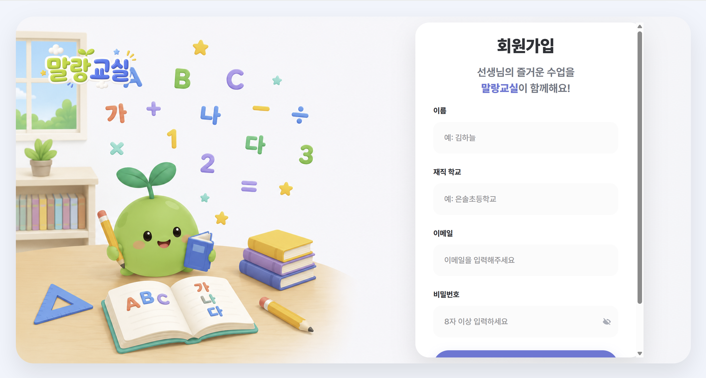
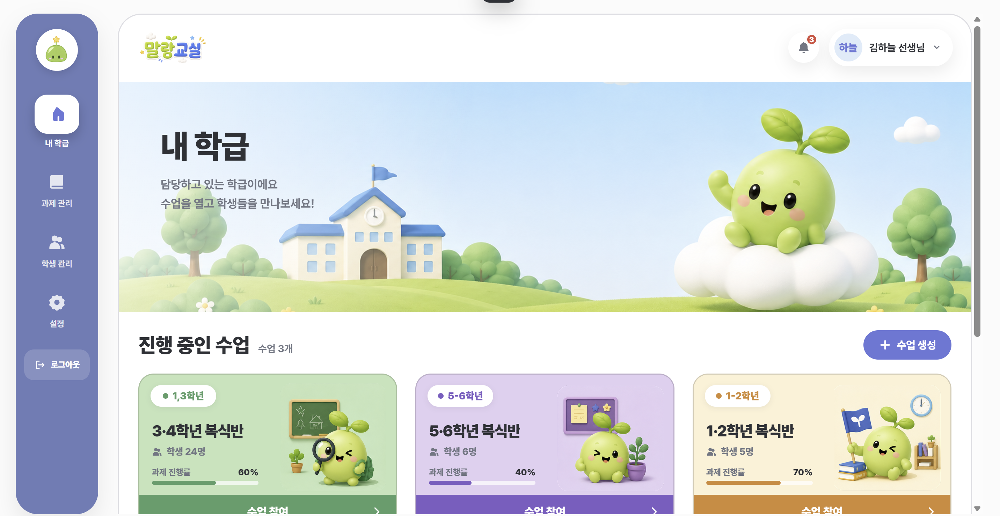
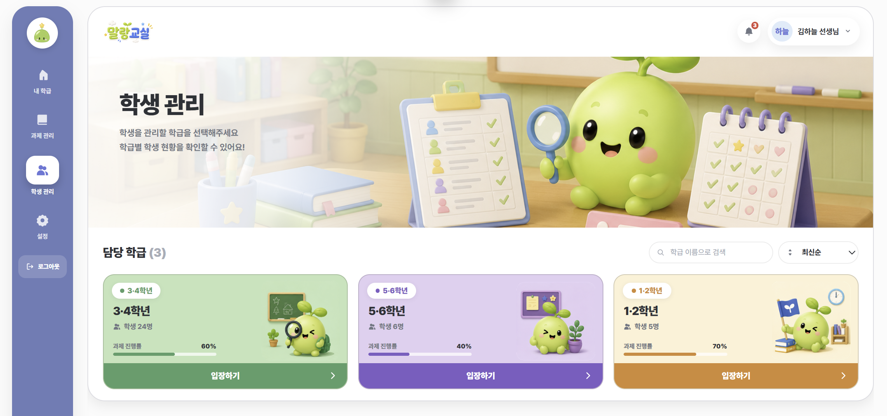
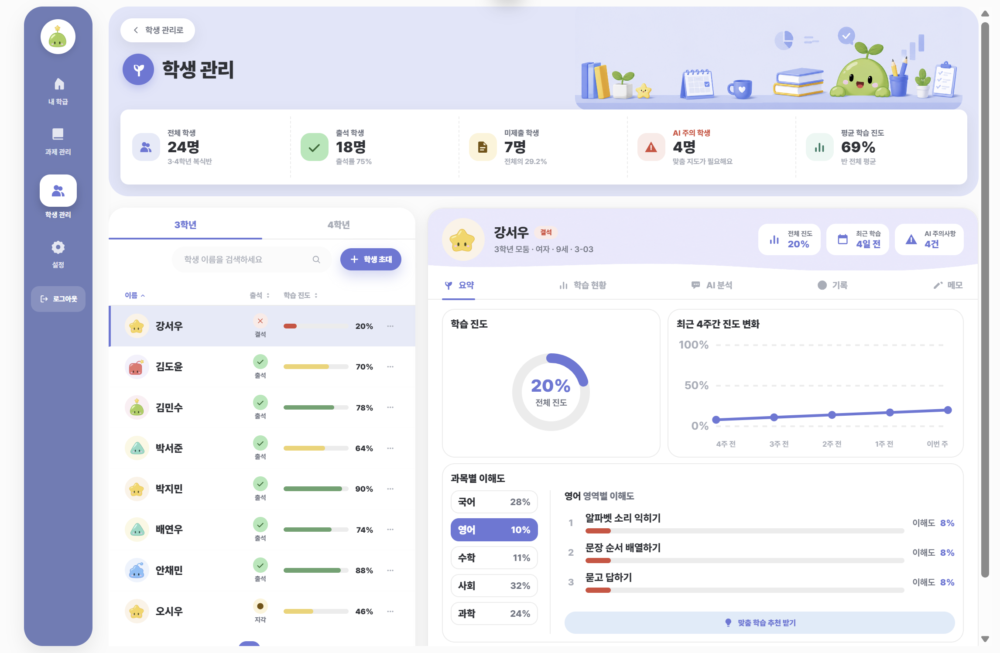
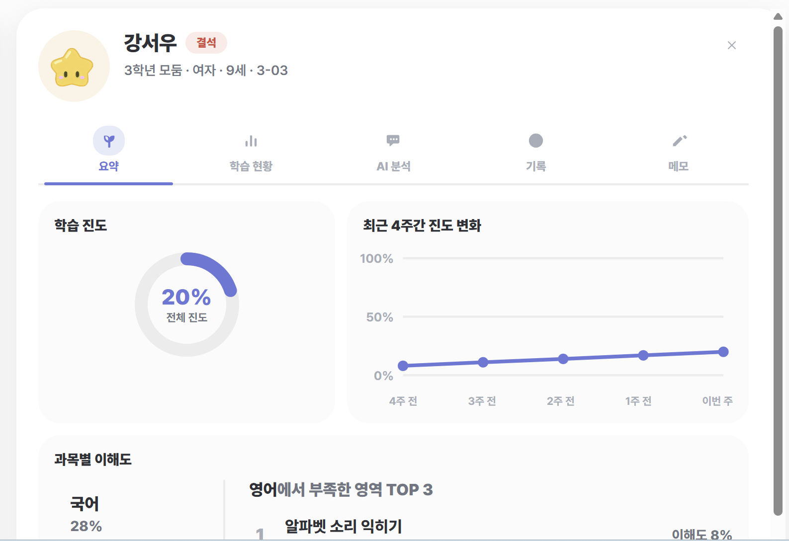
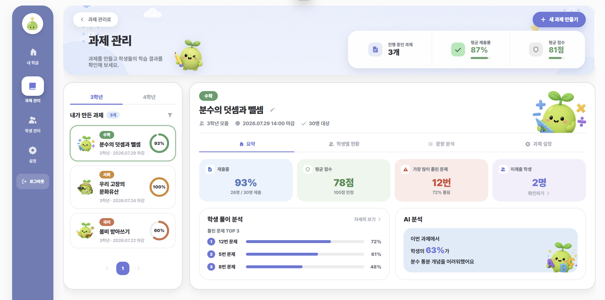

# 말랑교실 — 화면 소개

복식학급 통합 수업 관리 서비스 **말랑교실**의 화면을 하나씩 소개하는 문서입니다.
크게 **학생 화면**과 **선생님 화면** 두 갈래이고, 둘은 로그인 계정의 역할(role)로 갈립니다.

> 스크린샷은 `pics/` 폴더에 있습니다. 아직 채우지 못한 화면은 문서 맨 아래
> [남은 스크린샷](#남은-스크린샷)에 모아 뒀습니다.

---

## 화면 지도

| 경로 | 화면 | 대상 |
|---|---|---|
| `/login` · `/signup` | 로그인 / 회원가입 | 공용(가입은 선생님) |
| `/invite/:code` | 초대 수락 · 학생 가입 | 학생 / 선생님 |
| `/classroom` | 실시간 교실 | 학생 |
| `/teacher` | 내 학급 | 선생님 |
| `/teacher/pick` | 학급 선택 | 선생님 |
| `/teacher/classroom/:id/enter` | 학급 화면 (학년 선택) | 선생님 |
| `/teacher/classroom/:id` | 라이브 수업 | 선생님 |
| `/teacher/classroom/:id/manage` | 학급 관리 | 선생님 |
| `/teacher/classroom/:id/students` | 학생 관리 | 선생님 |
| `/teacher/classroom/:id/assignments` | 과제 관리 | 선생님 |
| `/teacher/chat` | 채팅 관리 | 선생님 |

`/` 로 들어오면 로그인 여부와 역할에 따라 학생은 `/classroom`, 선생님은 `/teacher` 로 보냅니다.

---

# 학생 화면

## 1. 로그인

**경로** `/login`

학생은 **선생님이 발급해 준 아이디와 비밀번호**로 들어옵니다. 학생이 스스로 가입하는 길은 없고,
계정은 선생님이 학급 관리에서 만들어 주거나 초대 링크로 만들어집니다.

왼쪽은 교실 일러스트, 오른쪽은 입력 카드인 2단 구성입니다. 카드 안에서 로그인/회원가입 탭이
바뀌며, 화면 이동은 없습니다.


## 2. 초대 수락 · 학생 가입

**경로** `/invite/:code`

선생님이 보낸 초대 링크로 들어오는 화면입니다. **로그인하지 않은 상태로 열면 학생 가입 폼**
(이름 · 학년 · 학교 · 비밀번호)이 나오고, 채우면 계정이 만들어지면서 그 학급에 바로 들어갑니다.

이미 로그인한 선생님이 같은 링크를 열면 폼 없이 수락되어 그 학급의 공동 관리자로 등록됩니다.
링크가 만료됐거나 대상이 어긋나면 그 사유를 화면에 그대로 안내합니다.

<!-- 스크린샷 준비 중 -->

## 3. 실시간 교실

**경로** `/classroom` — 학생이 로그인하면 바로 이 화면입니다.

수업 시간에 학생이 계속 머무는 화면입니다. 선생님이 수업을 시작하면 알림을 받아 자동으로
입장하고, 수업이 끝나면 안내 오버레이가 덮습니다. 화면 크기에 맞춰 전체 배율이 조정돼서
작은 노트북에서도 같은 비율로 보입니다.

왼쪽은 **선생님 방송**, 오른쪽은 **오늘의 과제**로 나뉩니다.


### 3-1. 선생님 방송 카드

선생님의 카메라·화면 공유가 나오는 자리입니다. 왼쪽 위에 LIVE 배지와 경과 시간이 붙고,
오른쪽 위 "전체 화면"으로 키울 수 있습니다. 아래쪽 마이크·카메라·손들기 버튼으로 수업에
참여합니다. 쉬는 시간에는 방송 위에 덮개가 씌워집니다.

<!-- 스크린샷 준비 중 (위 3번 사진의 왼쪽 영역) -->

### 3-2. 오늘의 과제

선생님이 **공개한 과제**만 모이는 카드입니다. "3개 중 1개 완료!"처럼 진행 상황을 먼저 알려주고,
끝낸 과제는 "다시 보기", 다음에 할 과제는 "다음 순서예요" 배지와 함께 "시작하기"가 붙습니다.
수업 중에 선생님이 새 과제를 공개하면 새로고침하지 않아도 바로 목록에 올라옵니다.

<!-- 스크린샷 준비 중 (위 3번 사진의 오른쪽 영역) -->

### 3-3. 선생님 쪽지

선생님이 나에게만 보낸 말이 쌓이는 자리입니다. 과제 바로 아래에 둬서 "지금 할 일"과
"선생님이 보낸 말"을 한 줄에서 볼 수 있습니다.

<!-- 스크린샷 준비 중 -->

### 3-4. 퀴즈 풀기

과제를 열면 교실 화면이 퀴즈 화면으로 바뀝니다. 문제를 하나씩 풀고, 정답이면 축하 효과가
터집니다. 다 풀면 다시 교실 화면으로 돌아옵니다.

<!-- 스크린샷 준비 중 -->

### 3-5. AI 말랑이

화면 오른쪽 아래에 늘 떠 있는 민트색 챗봇입니다. 모르는 걸 물어보면 답해 주고, 선생님을
기다리는 동안에도 혼자 공부를 이어갈 수 있습니다.

<!-- 스크린샷 준비 중 -->

---

# 선생님 화면

선생님 화면은 **수업 진행**과 **관리·설정**을 화면 단위로 나눠 둡니다. 왼쪽 딥블루 사이드바가
늘 같은 자리에 있고(내 학급 · 과제 관리 · 학생 관리 · 설정), 오른쪽 영역만 스크롤됩니다.

## 1. 로그인 · 회원가입

**경로** `/login` · `/signup`

선생님은 이름 · 재직 학교 · 이메일 · 비밀번호로 직접 가입합니다. 로그인 성공하면 내 학급으로
들어갑니다. 로그인과 회원가입은 같은 카드 안에서 탭으로만 바뀝니다.



## 2. 내 학급 (첫 화면)

**경로** `/teacher`

로그인하면 처음 보는 화면입니다. 담당하는 학급이 카드로 깔리고, **진행 중인 수업**과
**닫혀있는 수업**을 얇은 구분선으로 나눠 한 패널에 담습니다.

카드마다 학년 · 학생 수 · 과제 진행률이 있고, 카드를 누르면 그 학급으로 들어갑니다.
오른쪽 위 "수업 생성"으로 새 학급을 만듭니다.



## 3. 학급 선택

**경로** `/teacher/pick`

사이드바에서 **학급을 고르지 않은 채** 과제 관리나 학생 관리를 누르면 거쳐 가는 화면입니다.
"어느 학급의 학생을 볼까요?"를 카드 그리드로 묻습니다. 검색과 정렬(최신순 · 이름순 · 학생 많은 순)이
있습니다.

모달이 아니라 **화면**이라서 뒤로가기 · 새로고침 · 링크 공유가 모두 동작합니다.

> **화면 제목이 "학급 선택"이 아닙니다.** 들어온 문에 따라 배너에 **"학생 관리"** 또는
> **"과제 관리"** 라고 크게 뜹니다. 내 학급 화면과 구분하는 지점은 카드 버튼입니다 —
> 내 학급은 "수업 참여", 이 화면은 **"입장하기"** 이고 위쪽에 검색·정렬이 있습니다.



## 4. 학급 화면 (학년 선택)

**경로** `/teacher/classroom/:id/enter`

학급 카드를 눌러 들어오는 곳입니다. 복식학급이라 한 교실에 여러 학년이 섞여 있어서,
**어느 학년으로 수업을 시작할지** 여기서 고릅니다.

- 왼쪽: 다른 선생님들과 주고받는 **메시지 패널** (목록을 누르면 그 자리에서 대화창으로 바뀝니다)
- 오른쪽: **학년별 수업 카드**(학년 마스코트 + 수업 시작 버튼) + 오늘의 활동 피드

"수업 시작"을 누르면 실제로 수업 세션이 열리고 라이브 수업 화면으로 넘어갑니다.
이미 진행 중인 학년은 "수업 중"으로 회색 처리돼 눌리지 않습니다.


## 5. 라이브 수업

**경로** `/teacher/classroom/:id`

수업을 진행하는 화면입니다. **몰입형이라 사이드바가 없고**, 나가는 문은 배너의 "돌아가기"
하나뿐입니다.

- 칠판 느낌의 상단 배너 (수업 제목 · 경과 시간 · LIVE 배지)
- 내 방송 미리보기와 카메라 · 마이크 · 화면 공유 제어
- 수업 중 채팅 — 학생 질문이 실시간으로 들어옵니다
- 빠른 도구 — 과제 확인, 학습자료를 **화면을 떠나지 않고** 이 자리에서 바꿔 봅니다
- 학생 타일 그리드와 화면 판서

전체 음소거처럼 반 전체에 걸리는 조작은 개별 학생 제어와 다른 줄에 둬서 "일괄"과 "개별"을
눈으로 구분할 수 있게 했습니다.

<!-- 스크린샷 준비 중 -->

## 6. 학급 관리

**경로** `/teacher/classroom/:id/manage`

학급 카드의 톱니바퀴(또는 사이드바 "설정")로 들어오는 관리 화면입니다. 탭 세 개입니다.

| 탭 | 내용 |
|---|---|
| 개요 | 학생 수 · 선생님 수 · 진행 중 수업, 학급 이름 수정, 사람 초대, 지난 수업 기록 |
| 이해도 | 학급 전체 이해도 히트맵 — 어느 개념에서 반이 막혔는지 한눈에 봅니다 |
| 학습자료 | 수업에 쓸 자료 올리기·목록 |

"사람 초대"에서 다른 선생님용 **초대 링크**를 만들거나, **학생 계정을 직접 발급**할 수 있습니다.

<!-- 스크린샷 준비 중 -->

## 7. 학생 관리

**경로** `/teacher/classroom/:id/students`

학급 학생을 다루는 독립 화면입니다. 위쪽 배너에 전체 학생 수와 학급 통계가 나오고,
아래는 2단입니다.

- 왼쪽: **학생 목록** — 학년 탭 · 검색 · 학생 초대. 행마다 출석과 학습 진도 막대가 붙습니다
- 오른쪽: 고른 학생의 **상세 패널** — 요약 · 학습 현황 · AI 분석 · 기록 · 메모 탭

학생 행의 `⋯` 메뉴에서 비밀번호 재발급이나 학급에서 내보내기도 할 수 있습니다(되돌리기
어려운 일이라 확인 단계를 거칩니다).



### 7-1. 학생 상세 — 요약 탭

한 학생을 골랐을 때 오른쪽에 열리는 패널입니다. 전체 진도 도넛, 최근 4주간 진도 변화,
과목별 이해도와 **부족한 영역 TOP 3**가 차례로 나옵니다. 아래쪽 "맞춤 학습 추천 받기"로
이어집니다.

숫자는 색만으로 구분하지 않고 항상 퍼센트를 함께 적습니다.



## 8. 과제 관리

**경로** `/teacher/classroom/:id/assignments`

과제를 만들고 결과를 보는 독립 화면입니다. 배너에 진행 중인 과제 수 · 평균 제출률 · 평균 점수가
요약되고, 아래는 2단입니다.

- 왼쪽: **내가 만든 과제** 목록 — 학년 탭, 카드마다 제출률 링
- 오른쪽: 고른 과제의 상세 — 요약 · 학생별 현황 · 문항 분석 · 과제 설정 탭

요약 탭에서 제출률 · 평균 점수 · **가장 많이 틀린 문제** · 미제출 학생을 한눈에 보고,
아래 "학생 풀이 분석"에서 틀린 문제 TOP 3와 AI 분석 코멘트를 확인합니다.

"새 과제 만들기"는 단계별 마법사입니다 — 한 화면에 다 몰지 않고 진행 점(dot)을 따라
나눠 물어봅니다. AI로 문제 초안을 만들 수도 있습니다.



## 9. 채팅 관리

**경로** `/teacher/chat`

학생 질문을 모아 답장하는 화면입니다. 왼쪽은 학생별 대화 목록(안 읽은 것이 위), 오른쪽은
그 학생과의 대화와 답장 입력창입니다.

말풍선은 흔한 메신저 규칙을 따릅니다 — 학생은 왼쪽 회색, 나(선생님)는 오른쪽 파란색입니다.

<!-- 스크린샷 준비 중 -->

---

## 화면 이동 규칙

선생님 화면은 깊이(depth)가 있어서, 어디서 왔든 **길을 잃지 않는 것**을 규칙으로 둡니다.

```
내 학급  →  학급 화면  →  라이브 수업 / 학급 관리 / 학생 관리 / 과제 관리
```

- **뒤로가기는 한 단계만 올라갑니다.** 학생 관리에서 뒤로 가면 내 학급이 아니라 학급 화면입니다.
- **옆으로 새면 돌아올 길을 남깁니다.** 라이브 수업에서 학급 관리로 갔다가 뒤로 가면
  내 학급이 아니라 **그 수업으로** 돌아옵니다. 사용자가 직접 나가기를 누르지 않는 한
  수업 밖으로 튕기지 않습니다.
- **뒤로가기 버튼은 실제 목적지를 그대로 말합니다.** "학급 선택으로", "수업으로 돌아가기"처럼
  어디로 가는지 눌러 보기 전에 알 수 있게 씁니다.

---

## 남은 스크린샷

| 화면 | 위치 |
|---|---|
| 초대 수락 · 학생 가입 | 학생 2 |
| 선생님 방송 카드 (부분) | 학생 3-1 |
| 오늘의 과제 (부분) | 학생 3-2 |
| 선생님 쪽지 | 학생 3-3 |
| 퀴즈 풀기 | 학생 3-4 |
| AI 말랑이 | 학생 3-5 |
| 라이브 수업 | 선생님 5 |
| 학급 관리 (탭 3개) | 선생님 6 |
| 채팅 관리 | 선생님 9 |

---

## 함께 보기

- [디자인 가이드라인](../ref/DESIGN_GUIDELINES.md) — 색·타이포·컴포넌트 규칙
- [백엔드 연동](../BACKEND_INTEGRATION.md)
- [로드맵](../ROADMAP.md)
