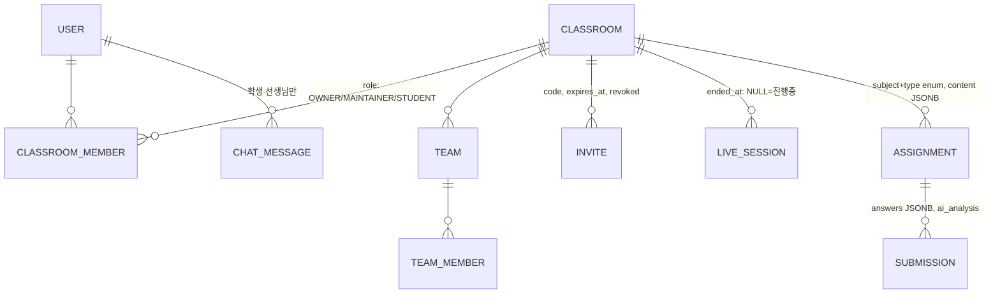

# 아키텍처

## 전체 구성

```
브라우저 (React)
  │ HTTPS/WSS
  ▼
Nginx :443  ── classroom.example.com
  ├ /            → React 정적 파일
  ├ /api/**      → Spring Boot :8080  (REST)
  └ /ws/**       → Spring Boot STOMP  (채팅·손들기·음소거 명령·팀 Lock)

LiveKit TLS :8443 ──→ LiveKit :7880   (시그널링, 미디어는 UDP 직결)

Spring Boot ── PostgreSQL (도메인 데이터, 과제 JSONB)
            ── Redis (초대코드 TTL, refresh 토큰, 수업 중 상태)
            ── LiveKit Server API (룸 생성, 토큰 발급, 강제 음소거)
            ── LLM API (문제 생성, 이해도 분석 — 비동기 처리)
```

- 미디어(캠/마이크/화면)는 LiveKit, 제어 신호는 Spring WebSocket으로 분리
- "전체 음소거"는 Spring이 LiveKit Server API로 서버 측 mute → 클라이언트 우회 불가
- 마이크·카메라 켜기는 서버가 강제하지 않고 STOMP 요청 후 사용자가 클라이언트에서 승인
- "팀 내에서만 미디어 접근"은 LiveKit room 권한 토큰으로 구현
- 현재 백엔드는 단일 인스턴스 + Spring STOMP simple broker. 다중 인스턴스 전환 시 RabbitMQ 등 외부 broker relay 도입

## ERD 뼈대



## 확장 대비 결정 사항

| 결정 | 이유 |
|---|---|
| JWT (stateless) | 백엔드 다중 컨테이너/무중단 배포 시 세션 공유 문제 제거 |
| 단일 STOMP simple broker | 현재 규모에서 운영 복잡도를 줄임. 다중 인스턴스 전환 시 외부 STOMP 브로커 도입 |
| ClassroomMember 멤버십 | 담당자 이양 = role 변경, 복수 학급 담당 = 레코드 추가 |
| 과제 content JSONB | 새 문제 유형 추가 시 DB 마이그레이션 불필요, JSONB 인덱싱 가능 |
| pgvector 포함 이미지 | 추후 문제 임베딩 기반 추천 시 CREATE EXTENSION 한 줄로 확장 |
| Classroom/LiveSession 분리 | 수업 종료 후 403 처리, 수업 이력·출석 확장 대비 |
