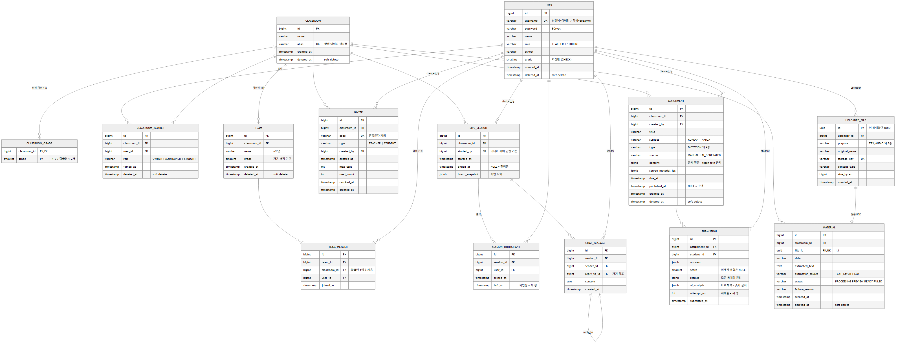
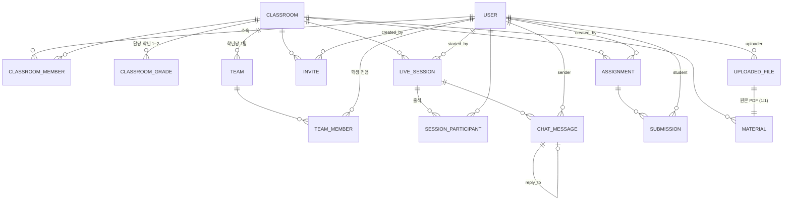

# ERD (v2.0 — 2026-07-30, 스키마 확정)

> API 명세서 v1.3과 세트. **테이블 14개** + Redis 네임스페이스(비관계형 상태).
>
> v2.0: 마이그레이션 V1~V11과 엔티티를 **전부 코드에서 다시 읽어** 작성했다. 이전 v1.4는 설계 시점
> 문서라 실제 적용된 스키마와 어긋난 곳이 있었다(아래 표). 컬럼·제약·인덱스는
> `backend/src/main/resources/db/migration/*.sql` 과 1:1로 대조했다.

## v1.4에서 실제로 달라진 것

| 항목 | v1.4 문서 | v2.0 (코드 확인) |
|---|---|---|
| 테이블 수 | 13개 | **14개** — `CLASSROOM_GRADE` 신설 (V11) |
| 팀 배정 | 선생님이 수동 편성 | **학년 자동 배정** — `team.grade` + `(classroom_id, grade)` 부분 유니크 (V5) |
| 학급 담당 학년 | 개념 없음 | `CLASSROOM_GRADE` 1~2개. 학생 등록 시 이 학년만 허용 |
| 팀 CRUD | API 있음 | **취소** — 테이블·팀 룸은 유지, 수동 관리 API만 제거 (명세 v1.1) |
| 미디어 잠금 | `session:{id}:mutes` (HASH) | `media:muted-mic` + `media:disabled-cam` (SET 2개) |
| 판서 Redis | 획 LIST 1개 | **4개** — LIST·ID SET·HASH·인덱스 플래그 (획 단위 삭제 지원) |
| 쉬는시간 Lock | `team:{tid}:locked` (팀 단위) | `broadcast-lock` (**수업 단위**) |
| 강퇴 | `session:{id}:kicked` | **미사용** — 강퇴 기능이 범위에서 제외됨 (명세 v1.1) |
| `invite:{code}` 캐시 | 있다고 표기 | **구현되지 않았다** — 초대 검증은 DB 조회 |

## 설계 원칙

| 원칙 | 내용 |
|---|---|
| 리소스 수명주기 | 핵심 도메인은 `deleted_at` soft delete. 연결 테이블은 hard delete, 초대·수업은 `revoked_at`·`ended_at` 상태 컬럼 |
| 타임스탬프 = 상태 | BOOLEAN 대신 시각 컬럼 (`ended_at`, `revoked_at`, `published_at`). NULL 여부가 상태, 시각 기록은 덤 |
| enum → VARCHAR | Java enum + `@Enumerated(EnumType.STRING)`. ORDINAL 금지, PG 네이티브 ENUM 미사용 |
| JSONB 확장 | 유형이 늘어나는 데이터(과제 content, 답안)는 JSONB — 유형 추가 시 마이그레이션 불필요 |
| 부분 유니크 인덱스 | "살아있는 행 중 1개" 제약(OWNER 1명, 진행중 수업 1개, 학년 팀 1개)은 PG partial unique index로 DB가 강제 |
| DB vs Redis | 기록으로 남을 것 = PostgreSQL / 수업 중에만 의미 있는 것 = Redis / 미디어 = 무저장 |
| 학습이력 비정규화 안 함 | 이해도·통계 테이블을 두지 않고 `SUBMISSION.results` 를 조회 시점에 집계 — 학급 20~30명 규모라 충분 |

**soft delete (6개)**: `USER` · `CLASSROOM` · `CLASSROOM_MEMBER` · `TEAM` · `ASSIGNMENT` · `MATERIAL`
→ Hibernate `@SQLDelete` + `@SQLRestriction` 으로 조회에서 자동 제외된다.

**hard delete**: `TEAM_MEMBER` · `CLASSROOM_GRADE` (연결·값 테이블)
**삭제 API 없음**: `SUBMISSION` · `CHAT_MESSAGE` · `SESSION_PARTICIPANT` · `UPLOADED_FILE` · `LIVE_SESSION`

---

## 전체 관계도

컬럼까지 담은 그림은 별도 파일로 있다. 아래 mermaid 블록은 관계만 보여주는 요약이다.

| 파일 | 용도 |
|---|---|
| [`erd.png`](erd.png) | 전체 그림 (컬럼·타입·키·주석 포함). 발표·리뷰용 |
| [`erd.svg`](erd.svg) | 같은 그림의 벡터본 — 확대해도 글자가 깨지지 않는다 |
| [`erd.mmd`](erd.mmd) | 위 두 그림의 **소스**. 스키마가 바뀌면 이 파일을 고치고 아래 명령으로 다시 뽑는다 |

```bash
npx -y @mermaid-js/mermaid-cli@11 -i docs/erd.mmd -o docs/erd.png -b white -t neutral -w 3200
```



### 관계 요약



---

## 테이블 상세

### 1. USER — 선생님/학생 단일 테이블

| 컬럼 | 타입 | 제약 | 설명 |
|---|---|---|---|
| id | BIGINT | PK, IDENTITY | |
| username | VARCHAR(255) | UNIQUE, NOT NULL | 선생님=이메일 / 학생=자동 생성 (`{학급alias}{2자리}`, 예: dodam01) |
| password | VARCHAR(255) | NOT NULL | BCrypt 해시. 평문은 발급 응답에서만 1회 노출 |
| name | VARCHAR(255) | NOT NULL | |
| role | VARCHAR(20) | NOT NULL | `TEACHER` \| `STUDENT` |
| school | VARCHAR(255) | NOT NULL | 선생님=재직교 / 학생=소속교 (복식학급은 두 학교 혼재) |
| grade | SMALLINT | NULL | **학생만**. 팀 자동 배정 기준 |
| created_at | TIMESTAMP | NOT NULL | |
| deleted_at | TIMESTAMP | NULL | soft delete |

```sql
CONSTRAINT users_role_grade_check CHECK (
    (role = 'STUDENT' AND grade IS NOT NULL) OR
    (role = 'TEACHER' AND grade IS NULL)
)
```

역할 전용 컬럼이 `grade` 하나뿐이라 단일 테이블을 유지한다. **3개 이상 늘어나면 `STUDENT_PROFILE`(1:1) 분리**가 기준선이다.

---

### 2. CLASSROOM — 학급

| 컬럼 | 타입 | 제약 | 설명 |
|---|---|---|---|
| id | BIGINT | PK | |
| name | VARCHAR(255) | NOT NULL | 예: "3학년 2반" |
| alias | VARCHAR(30) | NOT NULL | 학생 username 생성용. **서버가 단어 풀에서 자동 배정** (선생님 입력 없음) |
| created_at | TIMESTAMP | NOT NULL | |
| deleted_at | TIMESTAMP | NULL | soft delete |

학교명 컬럼이 없다 — 학급 상세의 `school` 은 OWNER 선생님의 `USER.school` 에서 도출한다. 복식학급에서 학생마다 학교가 다를 수 있어 학급에 못 박지 않았다.

`alias` 는 유일하지 않다 (V17). 살아있는 학급 둘이 같은 단어를 가질 수 있다. 유일성이 필요한 것은 `USER.username` 이고, 같은 alias 라면 발급 시점에 번호가 이어지므로(dodam01~05 / dodam06~10) 충돌하지 않는다. alias 에 유일성을 걸면 단어 풀 크기가 만들 수 있는 학급 수의 상한이 되기 때문에 걷어냈다.

---

### 3. CLASSROOM_GRADE — 학급 담당 학년 (V11 신설)

| 컬럼 | 타입 | 제약 |
|---|---|---|
| classroom_id | BIGINT | PK, FK → classroom |
| grade | SMALLINT | PK, `CHECK (grade BETWEEN 1 AND 6)` |

복합 PK만 있는 값 테이블 (id·타임스탬프 없음). JPA 에서는 `@ElementCollection` 으로 매핑한다.

- 학급당 **1~2개** (애플리케이션 검증). 학생 등록 시 이 학년이 아니면 `400 grade-not-in-classroom`
- 비어 있으면 제약을 걸지 않는다 — V11 백필에서 학년이 3개 이상 섞인 기존 학급은 비워 뒀다

---

### 4. CLASSROOM_MEMBER — 학급 소속·권한

| 컬럼 | 타입 | 제약 | 설명 |
|---|---|---|---|
| id | BIGINT | PK | |
| classroom_id | BIGINT | FK, NOT NULL | |
| user_id | BIGINT | FK, NOT NULL | |
| role | VARCHAR(20) | NOT NULL | `OWNER` \| `MAINTAINER` \| `STUDENT` — **USER.role과 별개** |
| joined_at | TIMESTAMP | NOT NULL | |
| deleted_at | TIMESTAMP | NULL | 학급 제외 = soft delete |

```sql
CONSTRAINT uq_classroom_member UNIQUE (classroom_id, user_id)

-- OWNER는 학급당 1명 (살아있는 행 기준)
CREATE UNIQUE INDEX one_owner_per_classroom ON classroom_member (classroom_id)
    WHERE role = 'OWNER' AND deleted_at IS NULL;
```

`UNIQUE (classroom_id, user_id)` 가 `deleted_at` 을 포함하지 않는다 → **재가입은 새 행이 아니라 기존 행 부활**이다. 모르고 insert 하면 유니크 위반이 난다.

---

### 5. TEAM — 팀 = 학급 내 같은 학년

| 컬럼 | 타입 | 제약 | 설명 |
|---|---|---|---|
| id | BIGINT | PK | |
| classroom_id | BIGINT | FK, NOT NULL | |
| name | VARCHAR(255) | NOT NULL | 자동 생성: `"{grade}학년"` |
| grade | SMALLINT | NULL | 자동 배정 기준 |
| created_at | TIMESTAMP | NOT NULL | |
| deleted_at | TIMESTAMP | NULL | soft delete |

```sql
CREATE INDEX idx_team_classroom ON team (classroom_id);

-- 같은 학급에 같은 학년 팀은 하나 (동시 생성 경합 방어)
CREATE UNIQUE INDEX uq_team_classroom_grade ON team (classroom_id, grade)
    WHERE deleted_at IS NULL;
```

**팀 관리 API는 없다** (명세 v1.1 취소). 테이블과 LiveKit 팀 룸은 그대로 쓰되 학생 등록 시 학년 팀에 자동 편입된다. 팀 정보는 `members`·`participants` 응답의 `teamId` 로만 노출된다.

---

### 6. TEAM_MEMBER — 팀 배정 (연결)

| 컬럼 | 타입 | 제약 |
|---|---|---|
| id | BIGINT | PK |
| team_id | BIGINT | FK, NOT NULL |
| classroom_id | BIGINT | FK, NOT NULL |
| user_id | BIGINT | FK, NOT NULL |
| joined_at | TIMESTAMP | NOT NULL |

```sql
CONSTRAINT uq_team_member_team_user      UNIQUE (team_id, user_id)
CONSTRAINT uq_team_member_classroom_user UNIQUE (classroom_id, user_id)  -- 학급당 1팀
CREATE INDEX idx_team_member_team ON team_member (team_id);
```

`classroom_id` 는 team 을 타고 가면 알 수 있지만, **"학급당 한 팀"을 DB로 강제**하려고 중복해서 들고 있다. hard delete 대상.

---

### 7. INVITE — 초대

| 컬럼 | 타입 | 제약 | 설명 |
|---|---|---|---|
| id | BIGINT | PK | |
| classroom_id | BIGINT | FK, NOT NULL | |
| code | VARCHAR(16) | UNIQUE, NOT NULL | **혼동 문자(0/O, 1/I/L) 제외** — 저학년이 종이에서 옮겨 적는 경로 |
| type | VARCHAR(20) | NOT NULL | `TEACHER`(기본 1회) \| `STUDENT`(기본 30회) |
| created_by | BIGINT | FK, NOT NULL | |
| expires_at | TIMESTAMP | NOT NULL | |
| max_uses | INT | NOT NULL | |
| used_count | INT | NOT NULL DEFAULT 0 | 수락 트랜잭션에서 원자적 증가 |
| revoked_at | TIMESTAMP | NULL | 즉시 만료 |
| created_at | TIMESTAMP | NOT NULL | |

```sql
CREATE INDEX idx_invite_classroom ON invite (classroom_id);
```

유효 판정: `expires_at > now AND revoked_at IS NULL AND used_count < max_uses` — **DB 조회로 검증**한다(Redis 캐시 없음).

---

### 8. LIVE_SESSION — 수업

| 컬럼 | 타입 | 제약 | 설명 |
|---|---|---|---|
| id | BIGINT | PK | |
| classroom_id | BIGINT | FK, NOT NULL | |
| started_by | BIGINT | FK, NOT NULL | **미디어 제어 권한의 기준** — 이 사람만 마이크·카메라·화면잠금 가능 |
| started_at | TIMESTAMP | NOT NULL | |
| ended_at | TIMESTAMP | NULL | **NULL = 진행중** (별도 status 컬럼 없음) |
| board_snapshot | JSONB | NULL | 종료 시 화이트보드 **획만** 박제. 배경(화면공유 영상)은 저장하지 않는다 |

```sql
-- 학급당 진행중 수업 1개 → 동시 시작 시 409의 근거
CREATE UNIQUE INDEX one_open_session_per_classroom ON live_session (classroom_id)
    WHERE ended_at IS NULL;
```

`GET /sessions/{id}/state` 는 `ended_at IS NULL` 만 조회하고, `GET /sessions/{id}`(상세)·`GET /classrooms/{id}/sessions`(이력)는 종료된 수업도 연다.

---

### 9. SESSION_PARTICIPANT — 출석

| 컬럼 | 타입 | 제약 |
|---|---|---|
| id | BIGINT | PK |
| session_id | BIGINT | FK, NOT NULL |
| user_id | BIGINT | FK, NOT NULL |
| joined_at | TIMESTAMP | NOT NULL |
| left_at | TIMESTAMP | NULL |

**재입장은 새 행**이다 (입퇴장 이력 보존). 따라서 참여 인원은 반드시 `count(DISTINCT user_id)` — 행을 세면 입장 *횟수*가 나온다.

LiveKit **메인 룸** 입퇴장 웹훅이 기록한다 (팀 룸 입퇴장은 프레즌스만 갱신).

---

### 10. CHAT_MESSAGE — 수업 채팅 + 수업 밖 1:1 (V14 확장)

| 컬럼 | 타입 | 제약 | 설명 |
|---|---|---|---|
| id | BIGINT | PK | |
| classroom_id | BIGINT | FK, NOT NULL | **대화의 문맥이자 권한 검증의 기준** (V14 신설) |
| session_id | BIGINT | FK, **NULL 허용** | 수업 밖 대화면 NULL (V14 로 NOT NULL 해제) |
| sender_id | BIGINT | FK, NOT NULL | 학생 질문·선생님 답장 공용 |
| recipient_id | BIGINT | FK, NULL | 받는 사람. 쪽지와 **선생님이 보낸 수업 채팅**에 있다. 학생이 보낸 수업 채팅만 비어 있다(대기열이 나중에 정한다) |
| reply_to_id | BIGINT | FK → chat_message, NULL | 자기 참조 |
| content | TEXT | NOT NULL | |
| read_at | TIMESTAMP | NULL | 수신자가 읽은 시각. `recipient_id` 가 있는 1:1 에서만 의미가 있다 |
| created_at | TIMESTAMP | NOT NULL | |

```sql
CREATE INDEX idx_chat_message_session   ON chat_message (session_id, created_at);
CREATE INDEX idx_chat_message_recipient ON chat_message (recipient_id, read_at, created_at DESC);
CREATE INDEX idx_chat_message_direct    ON chat_message (classroom_id, sender_id, recipient_id, created_at);
```

**두 갈래가 한 표에 산다** (V14):

| | session_id | recipient_id | 라우팅 |
|---|---|---|---|
| 수업 채팅 — 학생이 보냄 | 있음 | **없음** | 프레즌스·대기열이 나중에 계산 |
| 수업 채팅 — 선생님이 보냄 | 있음 | **있음** | 배정된 학생 한 명 |
| 쪽지(수업 밖 1:1) | **없음** | 있음 | 명시적 수신자 |

> ⚠ **계통을 가르는 것은 `session_id` 다. `recipient_id` 가 아니다.**
>
> 한동안 수업 채팅이 `recipient_id` 를 아예 안 써서 `recipient_id IS NOT NULL` 만으로도
> 쪽지가 걸러졌고, 쿼리 여럿이 그 우연에 기대고 있었다. 선생님 메시지에 수신자를 적기
> 시작하면서 그 판별은 깨졌다 — 쪽지 쿼리는 `session_id IS NULL` 로, 수업 쿼리는
> `session_id IS NOT NULL` 로 가려야 한다. 빠뜨리면 아이의 수업 질문이 쪽지함에
> 섞이거나 그 반대가 된다.
>
> 왜 선생님 쪽만 적는가: 학생이 보낼 때는 받을 사람이 아직 없을 수 있다(대기열).
> 선생님은 배정된 학생에게만 보낼 수 있어 발행 시점에 수신자가 확정돼 있다. 그리고
> 이 값이 없으면 답장 형식이 아닌 선생님 메시지가 DB 에서 학생과 이어지지 않아
> 이력 조회에서 통째로 사라진다.

**배정·대기열은 이 테이블에 없다** — 전부 Redis(부록 A). 메시지 저장은 라우팅보다 먼저 일어나므로 **대기열로 간 질문도 DB에는 남는다**.

`read_at` 은 **쪽지에서만** 의미가 있고, 상대가 나에게 보낸 것에만 찍는다. 내가 보낸 것까지 찍으면 상대 화면의 읽음 표시가 거짓이 된다. (수업 채팅의 읽음은 추적하지 않는다 — 읽음 처리 쿼리도 `session_id IS NULL` 로 가린다.)

---

### 11. ASSIGNMENT — 과제

| 컬럼 | 타입 | 제약 | 설명 |
|---|---|---|---|
| id | BIGINT | PK | |
| classroom_id | BIGINT | FK, NOT NULL | |
| created_by | BIGINT | FK, NOT NULL | |
| title | VARCHAR(255) | NOT NULL | |
| subject | VARCHAR(30) | NOT NULL | `KOREAN` \| `HANJA` |
| type | VARCHAR(30) | NOT NULL | `DICTATION` \| `MULTIPLE_CHOICE` \| `PARTICLE_CHOICE` \| `OX` \| `QUIZ_GAME` |
| source | VARCHAR(20) | NOT NULL | `MANUAL` \| `AI_GENERATED` (AI 활용 통계·뱃지용) |
| content | JSONB | NOT NULL | type별 문제 스키마. 문항 공통: `conceptTags`·`level`·`sourceRef` |
| source_material_ids | JSONB | NULL | 근거 학습자료 ID 배열 (MANUAL은 NULL) |
| due_at | TIMESTAMP | NULL | |
| published_at | TIMESTAMP | NULL | **NULL = 초안** (학생에게 안 보임) |
| created_at | TIMESTAMP | NOT NULL | |
| deleted_at | TIMESTAMP | NULL | soft delete |

```sql
CREATE INDEX idx_assignment_classroom ON assignment (classroom_id) WHERE deleted_at IS NULL;
```

`content` 가 문제 전문을 담은 큰 JSONB 라 **제출 목록 조회에서 이 테이블을 fetch join 하면 안 된다** — 제출 건마다 문제지가 통째로 딸려온다. 히트맵·내 제출 목록 쿼리는 필요한 칼럼만 뽑는다.

진행 중인 AI 생성 초안은 Redis `genjob:{jobId}` 에만 있고, 선생님이 확정할 때만 이 테이블에 행이 생긴다.

---

### 12. SUBMISSION — 제출 + 즉시 자동채점

| 컬럼 | 타입 | 제약 | 설명 |
|---|---|---|---|
| id | BIGINT | PK | |
| assignment_id | BIGINT | FK, NOT NULL | |
| student_id | BIGINT | FK, NOT NULL | |
| answers | JSONB | NOT NULL | 문항번호 → 답 |
| score | SMALLINT | NULL | 자동 채점 0~100. **채점 불가 유형은 NULL** (제출한 것은 사실) |
| results | JSONB | NOT NULL | 문항별 정오 `[{no, correct, conceptTags}]` — **모든 통계의 원천** |
| ai_analysis | JSONB | NULL | **선생님용** LLM 해석 캐시 (`errorPattern`·`comment`). **숫자 금지** |
| feedback | TEXT | NULL | **학생용** 과제 전체 AI 총평 (v2.1, 마이그레이션 V12). **숫자 금지** |
| attempt_no | INT | NOT NULL | 학생별 시도 번호 (1부터) |
| submitted_at | TIMESTAMP | NOT NULL | |

```sql
CONSTRAINT uq_submission UNIQUE (assignment_id, student_id, attempt_no)
CREATE INDEX idx_submission_assignment ON submission (assignment_id);
CREATE INDEX idx_submission_student    ON submission (student_id);
```

**학습이력·이해도 테이블은 없다.** 히트맵·리포트·과제별 정답률 전부 이 테이블의 `results` 를 조회 시점에 집계한다.

재제출이 새 행이므로 **집계할 때 최신 시도만 골라야 한다** — 안 그러면 표본이 부풀고 옛 오답이 계속 반영된다.

`score` / `ai_analysis` 역할 분리 원칙: **숫자는 통계가, 해석은 LLM이.**

`ai_analysis` 와 `feedback` 을 나눈 이유는 **읽는 사람이 다르기 때문**이다. `ai_analysis` 는 선생님이 보는
리포트용 해석(지도 제안)이고, `feedback` 은 학생이 '내 답안 다시보기'에서 보는 격려 총평이다.
한 칸을 나눠 쓰면 한쪽 기능이 다른 쪽 문장을 덮어쓴다. 둘 다 **온디맨드 + 캐시**로 채워진다.

---

### 12-A. STUDENT_NOTE — 학생 메모 (V13, 선생님 전용)

| 컬럼 | 타입 | 제약 | 설명 |
|---|---|---|---|
| id | BIGINT | PK | |
| classroom_id | BIGINT | FK, NOT NULL | 학급 종속 — 학생이 반을 옮기면 따라가지 않는다 |
| student_id | BIGINT | FK, NOT NULL | 메모의 대상 |
| author_id | BIGINT | FK, NOT NULL | 남긴 선생님. **수정·삭제는 이 사람만** |
| content | TEXT | NOT NULL | |
| created_at / updated_at | TIMESTAMP | NOT NULL | |

**학생 본인은 볼 수 없다.** 관찰 기록이라 본인 열람을 허용하면 선생님이 솔직하게 쓸 수 없다 —
리포트·출석("선생님 또는 본인")과 권한 기준이 다른 유일한 표다. 읽기는 학급 선생님 전체.

---

### 12-B. AI_TUTOR_MESSAGE — AI 말랑이 대화 (V15)

| 컬럼 | 타입 | 제약 | 설명 |
|---|---|---|---|
| id | BIGINT | PK | |
| classroom_id | BIGINT | FK, NOT NULL | 열람 권한의 기준 |
| student_id | BIGINT | FK, NOT NULL | |
| question / answer | TEXT | NOT NULL | |
| answered_by | VARCHAR(20) | NOT NULL | `LLM` \| `TEMPLATE`(키 없음·호출 실패 시 폴백) |
| created_at | TIMESTAMP | NOT NULL | |

기록을 남기는 이유는 **안전**(저학년이 무엇을 묻고 답받았는지 선생님이 확인)과 **비용 추적**이다.
대화 스레드를 만들지 않는다 — 한 번의 질문·답이 완결된 단위이고, 문맥 이어붙이기는 토큰 비용과
프롬프트 주입 위험을 함께 키운다.

---

### 13. UPLOADED_FILE — 업로드 원본

| 컬럼 | 타입 | 제약 | 설명 |
|---|---|---|---|
| id | **UUID** | PK | **이 테이블만 UUID** — 순번이면 `/api/files/1/content` 부터 훑을 수 있다 |
| uploader_id | BIGINT | FK, NOT NULL | |
| purpose | VARCHAR(30) | NOT NULL | `TTS_AUDIO` \| `RECORDING` \| `BOARD_IMAGE` \| `LEARNING_MATERIAL` |
| original_name | VARCHAR(255) | NOT NULL | 표시용 원본 파일명 |
| storage_key | VARCHAR(255) | UNIQUE, NOT NULL | 내부 저장 경로 키. 절대경로는 `mallang.media.root` 와 조합 |
| content_type | VARCHAR(100) | NOT NULL | purpose별 허용 타입 검증 |
| size_bytes | BIGINT | NOT NULL | purpose별 상한: 음성·이미지 10MB / PDF 20MB |
| created_at | TIMESTAMP | NOT NULL | |

```sql
CREATE INDEX idx_uploaded_file_uploader ON uploaded_file (uploader_id);
```

**로컬 디스크 저장** (S3 미사용). 다운로드는 인증 필수이며, 저장 디렉터리를 Nginx 정적 경로로 노출하지 않는다.

---

### 14. MATERIAL — 학습자료 (AI 생성의 grounding 원천)

| 컬럼 | 타입 | 제약 | 설명 |
|---|---|---|---|
| id | BIGINT | PK | |
| classroom_id | BIGINT | FK, NOT NULL | |
| file_id | UUID | FK → uploaded_file, **UNIQUE**, NOT NULL | 1:1 |
| title | VARCHAR(255) | NOT NULL | |
| extracted_text | TEXT | NULL | 추출 결과 캐시 — 생성마다 재추출하지 않으려고 |
| extraction_source | VARCHAR(20) | NULL | `TEXT_LAYER`(1단계, 무료) \| `LLM`(2단계, 스캔본) |
| status | VARCHAR(20) | NOT NULL | `PROCESSING` → `PREVIEW` → `READY` / `FAILED` |
| failure_reason | VARCHAR(255) | NULL | |
| created_at | TIMESTAMP | NOT NULL | |
| deleted_at | TIMESTAMP | NULL | soft delete — 기존 과제의 `source_material_ids` 가 참조하므로 |

```sql
CREATE INDEX idx_material_classroom ON material (classroom_id);
```

**`PREVIEW` 는 선생님 확인 대기 상태**다. 추출 품질이 나쁜 자료로 과제를 만들면 문제가 이상해지므로, 확인을 거쳐야 `READY` 가 되고 그때부터 생성에 쓸 수 있다.

---

## 부록 A — Redis 네임스페이스

DB에 남기지 않는 "수업 중에만 의미 있는" 상태. 유실되면 재라우팅·재조회로 복구된다.

### 수업 상태 — `session:{sessionId}:*`

수업 종료 시 `session:{id}:*` 를 SCAN 해서 **일괄 삭제**한다 (KEYS 는 블로킹이라 쓰지 않는다).

| 키 | 자료구조 | 내용 |
|---|---|---|
| `session:{id}:hands` | SET | 손든 학생 id (토글) |
| `session:{id}:media:muted-mic` | SET | 마이크 발행 잠금 학생 id |
| `session:{id}:media:disabled-cam` | SET | 카메라 발행 잠금 학생 id |
| `session:{id}:broadcast-lock` | STRING | 존재 = 쉬는 시간 화면 잠금 (**수업 단위**) |
| `session:{id}:board:grants` | SET | 판서 권한 보유 학생 id |
| `session:{id}:board:strokes` | LIST | 획 JSON (그린 순서) — 종료 시 `board_snapshot` 으로 박제 |
| `session:{id}:board:stroke-ids` | SET | strokeId 중복·부활 방지 |
| `session:{id}:board:stroke-map` | HASH | strokeId → 획 JSON (단건 삭제용) |
| `session:{id}:board:stroke-map-ready` | STRING | 인덱스 구축 완료 플래그 |
| `session:{id}:board:members` | SET | 판서 참여자 |
| `session:{id}:team:{teamId}:teachers` | SET | 팀 룸에 있는 선생님 id (웹훅 갱신) |
| `session:{id}:{role}:{userId}:current-team` | STRING | 현재 있는 팀 룸. **키 없음 = 메인 룸** |
| ~~`session:{id}:kicked`~~ | — | **미사용** — 강퇴 기능이 범위에서 제외됨 |

판서 키가 4개인 이유: 획 **단건 삭제**를 지원하려면 순서(LIST)만으로는 부족하다. HASH 로 strokeId 를 찾고, SET 으로 중복·부활을 막고, 플래그로 기존 수업의 LIST 재인덱싱을 한 번만 한다.

### 프레즌스 — `presence:*` (전역, 세션 무관)

| 키 | 자료구조 | 내용 |
|---|---|---|
| `presence:online:teachers` | SET | STOMP 접속 중인 선생님 |
| `presence:teachers:in-class` | SET | 팀 룸에 들어가 있는 선생님 (= 지금 바쁨) |
| `presence:teacher:{id}:last-session` | STRING | 마지막으로 들어간 수업 id — 같은 수업 내 팀 순회와 타 수업 이동을 구분한다 (S15P11A407-132) |

"한가한 선생님" = `online` **차집합** `in-class`.

`last-session` 은 팀 룸을 나가도 지우지 않는다. 순회 중간(A 퇴장 ~ B 입장)에 비면 같은 수업인지 판단할 수 없기 때문이다. 세션이 아니라 선생님에 귀속되므로 `session:{id}:*` 일괄 삭제 대상도 아니다.

### 채팅 배정·대기열 — `chat:*` (전역)

수업 종료가 아니라 **배정 종료 조건**에서 명시적으로 지운다 — `session:{id}:*` 와 수명이 다르다.

| 키 | 자료구조 | 내용 |
|---|---|---|
| `chat:assign:student:{studentId}` | STRING | 배정된 선생님 id (sticky) |
| `chat:assign:teacher:{teacherId}` | SET | 담당 학생 id — **1:N** |
| `chat:waiting` | LIST | 대기열 (FIFO: leftPush / rightPop) |
| `chat:waiting:members` | SET | 중복 등록 방지 — SADD 원자성으로 번호표 1개 보장 |
| `chat:pending:{studentId}` | LIST | 대기 중 쌓인 메시지 `"{sessionId}:{content}"` — 배정 순간 일괄 전달 |

선생님이 한가해지면 **대기열 전체**를 그 사람이 가져간다 (한 명씩 나누지 않음 — 팀 확정).

### 기타

| 키 | TTL | 내용 |
|---|---|---|
| `genjob:{jobId}` | 24시간 | AI 과제 생성 작업 상태·초안. 확정 시에만 `ASSIGNMENT` 행 생성 |
| `refresh:{userId}` | 14일 | refresh 토큰 (회전 — 항상 최신 1개만 유효). 로그아웃·비밀번호 변경 시 DEL |

---

## 부록 B — 코드로 지키는 규칙 (DB 제약으로 표현 불가)

1. `CLASSROOM_MEMBER.role` 이 OWNER/MAINTAINER 인 행의 user 는 `USER.role = TEACHER` 여야 한다
2. `TEAM_MEMBER` 에는 `USER.role = STUDENT` 만 삽입한다
3. `TEAM.classroom_id == TEAM_MEMBER.classroom_id` 일치 (비정규화 컬럼 정합성)
4. 학급 제외 후 재가입 = 새 행이 아니라 기존 행 `deleted_at` 해제 (UNIQUE 제약 때문)
5. `SUBMISSION` 은 `published_at IS NOT NULL AND (due_at IS NULL OR due_at > now)` 인 과제에만 허용
6. OWNER 는 구성원 제외 대상이 될 수 없고, MAINTAINER 해제는 OWNER 만 수행한다
7. 초대 수락은 조건부 UPDATE 로 `used_count < max_uses` 를 원자적으로 보장한다
8. `generate` 의 materialIds 는 전부 `status = READY` 이고 요청 학급 소속(또는 내장 `builtin-*`)이어야 한다 — 위반 시 409
9. 학생 등록 시 `USER.grade` 가 `CLASSROOM_GRADE` 에 있어야 한다 (비어 있으면 검사하지 않음)
10. 학급 담당 학년은 1~2개 (DB CHECK 는 값 범위 1~6 만 본다)
11. 미디어 제어는 `LIVE_SESSION.started_by` 본인만 가능하다 (OWNER/MAINTAINER 아님)
12. 통계 집계 시 `SUBMISSION` 은 학생·과제별 **최신 `attempt_no` 만** 사용한다

---

## 부록 C — 저장하지 않는 것

| 대상 | 이유 |
|---|---|
| 오디오·비디오 스트림 | LiveKit SFU 중계만. 녹화 없음 |
| 화이트보드 배경 | 화면공유 영상은 재현 불가 — 획만 상대좌표(0~1)로 저장 |
| 단일 이해도 점수 | 서열화 방지. 태그별 정답률 + 신호등 밴드만 노출 |
| 학습이력 집계 테이블 | `SUBMISSION.results` 실시간 집계로 충분 (학급 20~30명) |
| 채팅 배정·대기열 | Redis 전용. 유실되면 다음 메시지에서 재라우팅 |
