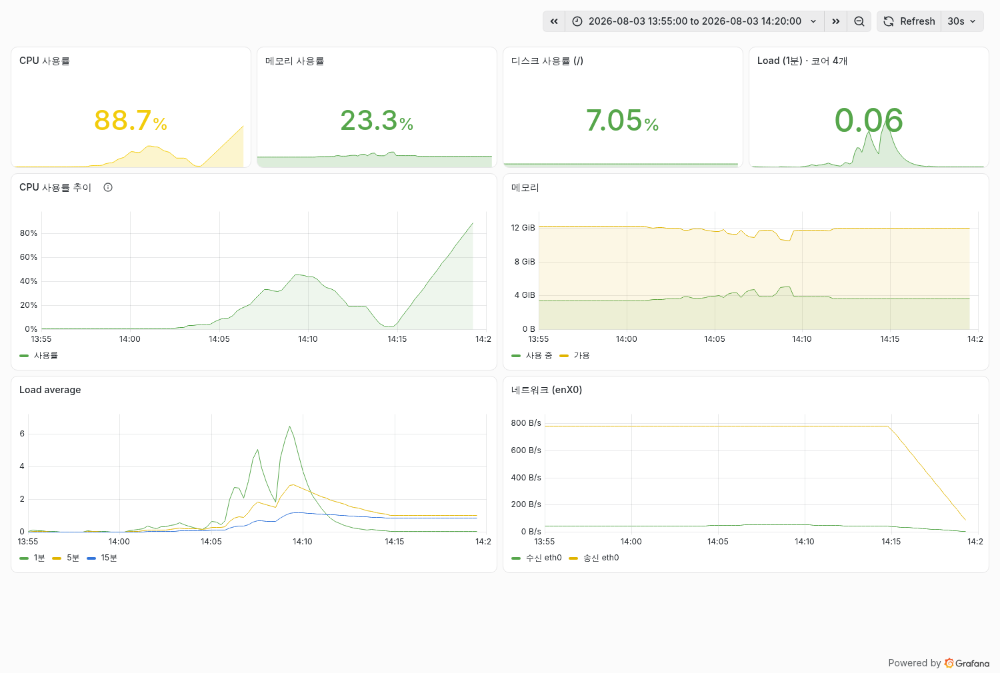
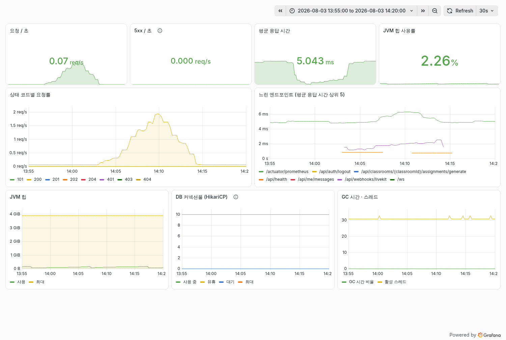

# 부하 테스트 리포트 — 동시에 몇 학급까지 가능한가

> 측정일 2026-08-03 · 대상 `classroom.example.com` · 인스턴스 **t2.xlarge**(4 vCPU / 15 GiB, Lightsail)
> 도구 `livekit-cli 2.18.2` · 스크립트는 `infra/server/monitoring/` 에 있다.

가상 참가자를 실제로 접속시켜 LiveKit 서버의 한계를 측정했다. 학급 단위(10명)와 단일
대형 룸 두 방식으로 재고, CPU·패킷 손실·대역폭을 함께 기록했다.

---

## 결론

| | 규모 | 판정 |
|---|---|---|
| 🟢 **안전** | **4학급 · 40명** | 패킷 손실 0.19% 이하, 전 학급 트랙 완전 확립. 시연은 이 범위에서. |
| 🟡 **가능하나 열화** | 6학급 · 60명 | 일부 학급 손실이 1.38% 로 상승. 눈에 띌 수 있다. |
| 🔴 **포화** | 8학급 · 80명 | 호스트 부하 6.36(코어 4개). 측정 자체가 의미를 잃는 구간. |

다만 이 숫자는 **보수적인 하한**이다. 부하 생성기가 같은 서버에서 돌며 CPU를 함께 썼기
때문이다. 실제 운영에서는 클라이언트가 학생 PC에 있으므로 서버 여력은 이보다 크다 —
아래 [측정의 한계](#측정의-한계) 참고.

---

## 학급 단위 측정

학급 하나를 룸 하나로 보고 동시에 띄웠다. **학급당 10명** — 선생님과 발표 학생 2명이
영상을 송출(3)하고, 나머지 7명은 시청(7). 룸당 다운스트림 21트랙이다.

`lk load-test` 의 퍼블리셔는 서로를 구독하지 않는 것을 먼저 확인했다(송출 10·구독 0으로
돌렸을 때 구독자 요약이 나오지 않음). 그래서 시청 부하는 구독자 수로 만들었다.

| 학급 | 총원 | LiveKit CPU | 부하 생성기 | 합계 | 트랙 확립 | 최대 패킷 손실 |
|---|---|---|---|---|---|---|
| 2학급 | 20명 | 71.8% | 51.3% | 123.1% | 21/21 | — |
| **4학급** | **40명** | **139.7%** | **102.2%** | **241.9%** | **21/21** | **0.189%** |
| 6학급 | 60명 | 180.4% | 144.9% | 325.3% | 21/21 | **1.378%** |
| 8학급 | 80명 | 171.7% | 165.4% | 337.1% | 21/21 | 0.787% |

CPU는 코어 4개 기준 **400% 가 만점**이다. 트랙 확립은 전 구간에서 완전했다 — 접속에
실패하거나 튕긴 참가자는 없었다.

**8학급에서 LiveKit이 6학급보다 오히려 낮다.** 부하가 줄어서가 아니라 생성기에 밀려
CPU를 못 받은 것이다. 이 역전이 측정 한계에 닿았다는 신호다.

---

## 대시보드 실측 화면

위 수치를 만든 그 시간대(22:55–23:20 KST)의 Grafana 화면이다. 가공하지 않은 원본이다.



**서버 자원.** `CPU 사용률 추이`가 0%에서 계단식으로 올라 **88.7%** 까지 닿는다. 아래
`Load average` 의 1분선(초록)이 **6** 을 넘는데, 코어가 4개이므로 대기줄이 생겼다는
뜻이다. 메모리는 23.3% 로 내내 여유로웠다.



**백엔드.** 이쪽이 더 중요한 증거다 — **5xx가 전 구간 0.000 req/s** 로 평평하고, 평균
응답 시간은 5ms 를 유지했다. 요청률이 2 req/s 로 솟은 것은 LiveKit 웹훅(상태코드 101)이다.
DB 커넥션풀은 아예 건드려지지 않았다. **80명 부하 중에도 웹 서비스는 영향을 받지 않았다.**

> ⚠️ 네트워크 패널은 이 구간에서 읽지 말 것. node_exporter 가 호스트가 아니라 자기
> 컨테이너의 인터페이스를 보고 있던 설정 오류를 **측정이 끝난 뒤에** 고쳤다. 이 시간대에는
> 옛 `eth0` 값(800 B/s)만 남아 있고, 실제 랜카드 `enX0` 수치는 이후 구간부터 기록된다.

---

## 왜 끊기는가

화상수업 서버는 참가자가 보낸 영상을 받아 나머지 전원에게 복사해 나눠준다. 학급 6개면
초당 수백 번의 복사가 일어나고, 이 일은 전적으로 CPU를 쓴다.

CPU가 모자라면 영상 조각이 **줄을 서서 기다리게** 된다. 그런데 영상은 늦게 도착하면
쓸모가 없다 — 이미 지나간 장면이다. 그래서 서버가 늦은 조각을 버리고, 그것이 화면에서
끊김으로 보인다.

### 아닌 것들도 확인했다

- **네트워크 아님** — 최대 102.9 Mbps. 인스턴스 대역폭에 한참 못 미친다.
- **AWS 조절 아님** — CPU steal 최대 3.47%. 크레딧이 소진됐다면 훨씬 높았을 값이다.
- **메모리 아님** — 최대 23.7%. 15 GiB 중 여유가 컸다.
- **백엔드 아님** — 부하 구간 내내 5xx 응답 0건. 웹·API 정상.

---

## 측정의 한계

### 숫자를 그대로 읽으면 안 되는 이유

부하 생성기가 **같은 서버 안에서** 돌았다. 서버가 "수업 중계"와 "가상 학생 연기"를 동시에
한 셈이다. 8학급에서 생성기가 165.4% 를 가져갔고, LiveKit은 그만큼 굶었다.

실제 수업에서는 학생들이 각자 PC로 접속하므로 서버는 중계만 한다. **따라서 실제 한계는
위 표보다 높다.** 정확한 값이 필요하면 생성기를 별도 장비에서 돌려야 한다.

### 앞으로의 위험 — 버스터블 인스턴스

`t2.xlarge` 는 CPU 크레딧 방식이다. 지속 가능한 기준선은 약 0.9 vCPU(전체의 22.5%)이고,
측정 때는 그 **15배** 를 썼다.

45초짜리 측정이라 크레딧이 버텼다(steal 3.47%). 하지만 **실제 수업은 40분씩** 이어진다.
여러 학급을 장시간 돌릴 계획이라면 크레딧 잔량을 지켜봐야 한다.

잔량은 서버 안에서 확인할 수 없다 — 인스턴스 역할(`AmazonLightsailInstanceRole`)에
CloudWatch·Lightsail API 권한이 없다. **Lightsail 콘솔 → 인스턴스 → 지표 탭 → CPU 사용률**
에서 버스트 용량으로 확인한다.

---

## 참고 · 단일 룸 측정

학급 단위 측정에 앞서, 한 방에 인원을 몰아넣는 방식으로도 쟀다. 전원이 영상을 송출하는
최악 조건이다.

| 퍼블리셔 | LiveKit 평균 | 최대 | 대역폭 | 패킷 손실 | 메모리 |
|---|---|---|---|---|---|
| 5 | 45.7% | 195.4% | 18.9 Mbps | 0.114% | 108 MB |
| 10 | 76.9% | 195.5% | 32.1 Mbps | 0.006% | 166 MB |
| 20 | 116.9% | 208.6% | 74.2 Mbps | 0.099% | 290 MB |
| 30 | 146.7% | 202.4% | 102.9 Mbps | 0.113% | 422 MB |

메모리는 퍼블리셔당 약 12 MB 씩 늘었다. 이 방식에서는 트랙 확립률이 낮게 나왔는데
(30명에서 180/900), 서버 한계가 아니라 확립 속도(초당 약 4트랙)와 측정 시간의 문제였다.
학급 단위로 나누자 전 구간 완전 확립됐다.

---

## 재현 방법

두 스크립트 모두 `infra/server/monitoring/` 에 있다.

```bash
# 단일 룸 — 퍼블리셔 / 구독자 / 지속시간
./livekit-loadtest.sh 30 30 60s

# 학급 단위 — 학급수 / 송출 / 시청 / 지속시간
./livekit-multiroom-test.sh 4 3 7 60s
```

- 진행 중인 세션이나 최근 5분 내 실제 접속이 있으면 **스스로 멈춘다.**
- 룸 이름은 `loadtest-<타임스탬프>` — 실제 세션(`session-N`)과 겹치지 않는다.
- 비대화형 실행에서는 확인을 받을 수 없으므로 실패한다. 강행은 `LOADTEST_FORCE=1`.

대시보드 캡처는 Grafana 렌더러로 뽑는다(`infra/server/monitoring/README.md` 참고).

```bash
curl -u "admin:$PW" -o server.png \
  "http://127.0.0.1:3000/grafana/render/d/mallang-server?orgId=1&from=$FROM&to=$TO&width=1500&height=1010&scale=1&kiosk=true&theme=light"
```

---

## 측정 방법 주기

- CPU·steal·메모리는 Prometheus(node_exporter) 실측, 컨테이너별 CPU는 `docker stats` 1초 샘플링.
- 패킷 손실·대역폭·트랙 확립은 `lk load-test` 가 보고한 값.
- 부하 구간에 실제 사용자가 없음을 확인하고 진행했다(열린 세션 0, 최근 접속 0).
